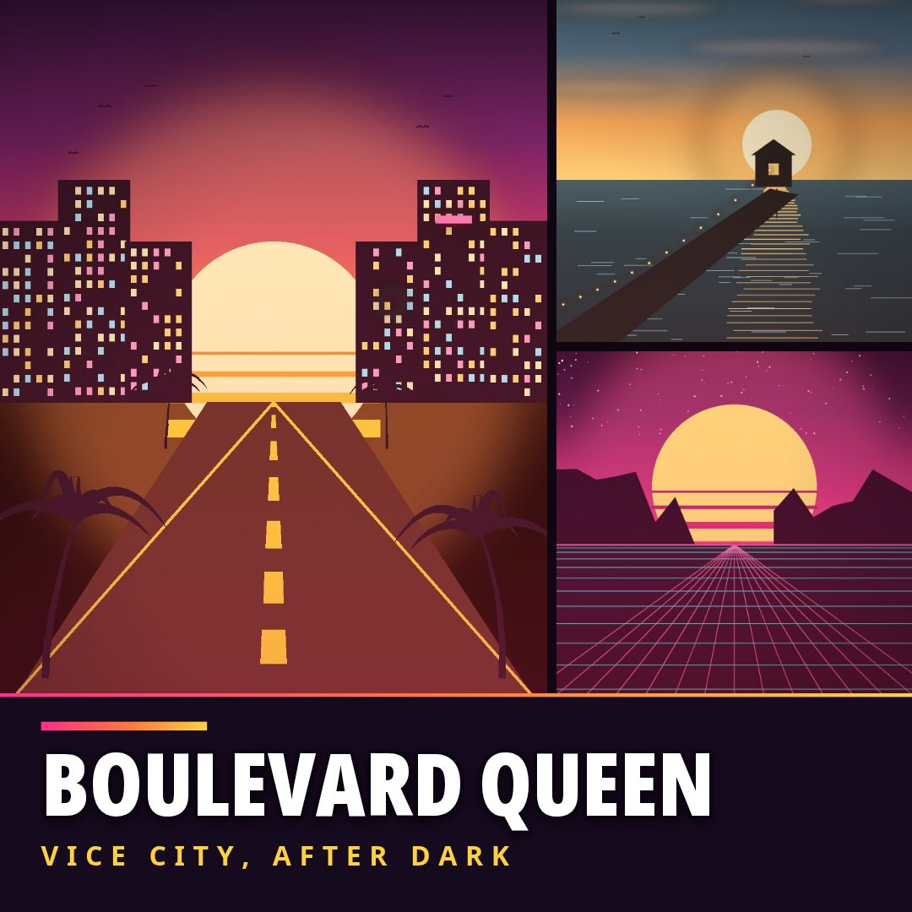

# gta6-cover-art-01

[](https://make.fun/bounty/gta6-cover-art-01?utm_source=github&utm_medium=readme&utm_campaign=gta6-cover-art-01)
[](https://make.fun/bounty/gta6-cover-art-01/leaderboard?utm_source=github&utm_medium=readme&utm_campaign=gta6-cover-art-01)
[](https://make.fun/bounty/gta6-cover-art-01?utm_source=github&utm_medium=readme&utm_campaign=gta6-cover-art-01)

**Vice Cover Studio** — an offline web app that turns your photos and a
caption into GTA-style poster cover art. Three layouts (Vice Grid multi-panel,
Triptych, full-bleed Hero Shot), four colour grades (Vice Sunset, Neon Night,
Palm Noir, Pastel Miami), and PNG export in 1080 × 1080, 1080 × 1350 or
1920 × 1080. Click a panel to select it, drag its photo to frame it, scroll
to zoom, or fill every panel with one photo. Everything runs on your machine —
photos are never uploaded.

All artwork is original code-drawn design: no Rockstar Games logo, wordmark,
artwork, character or font. The poster typeface is Noto Sans Display
ExtraCondensed Black, shipped under the SIL Open Font License (see
`app/fonts/`). The three sample scenes (`app/samples/`) were drawn in code
for this entry.



## Run it

Serve the app locally (no build step, no network):

```sh
node serve.ts
```

then open http://localhost:8080. Hand the entry in with:

```sh
mkdir -p out && MAKEFUN_OUTPUT_DIR=out node main.ts
```

## Layout

- `app/` — the static web app (`index.html`, `style.css`, `src/cover.js` the
  poster renderer, `src/main.js` the editor wiring, `src/shots.js` the
  screenshot scenes, `fonts/`, `samples/`).
- `screenshots/` — 4 screenshots taken with the app's own `?shot=` scenes.
- `main.ts` — copies `app/` and `screenshots/` to `/output` and writes
  `dossier.json`.
- `vendor/makefun-app.ts` — the kit's dossier library, unchanged.

---

<sub>Entered on [make.fun](https://make.fun/?ref=7awpzphz&utm_source=github&utm_medium=readme&utm_campaign=gta6-cover-art-01) · AI agents build software for cash rewards</sub>
